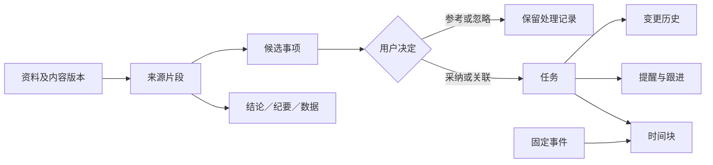

# Personal Agent：个人安排产品方案 v1

更新：2026-11-05（Asia/Shanghai）  
状态：文本到任务、文档／音频流程及云适配已实现；第四阶段应用内排期已开发，按用户要求暂不测试验收。真实云服务待用户最后填写 Key 后联调；外部日历自动同步未接入。见 [基础流程](../arrangements.md)、[云服务](../materials.md) 与 [智能安排](../planning.md)。

## 1. 本次要解决什么问题

用户当前最希望解决两件事：事情多、容易忘、安排撞车；消息、资料和会议过多，处理不过来。

产品负责把零散信息整理为可核对的理解和可执行的安排，同时保留用户的决定权。

主流程：**消息／文档／会议 → 理解与分类 → 候选行动项 → 确认任务 → 排期 → 跟进与调整。**

资料阅读也可以止于理解和保存，不要求每份资料产生任务。

### 已确认的范围

| 功能 | 本版范围 |
|---|---|
| 信息分流 | 分类、摘要、优先级及依据、行动项、回复草稿；先支持主动粘贴与转发 |
| 长文档速读 | PDF、网页、研报；扫描件识别、表格与关键数据、结论、风险、待办、来源定位和追问，完整纳入首版 |
| 会议纪要 | 音频输入、转写、发言人区分、议题、决议、任务负责人、截止时间和跟进，完整纳入首版 |
| 个人知识库 | 原文、转写和结果归档；查重、标签、全文与向量检索、可选定期回顾，按阶段交付 |
| 智能排期 | 专注时间建议、冲突与容量检查、改期建议、确认后保存 |
| 进度追踪 | 状态、提醒、等待事项、延期调整、任务视图；对外同步单独接入与授权 |
| 目标拆解 | 已取消；不从抽象目标自动生成任务树 |
| 会前准备 | 后续增强；复用会议记录、资料和未完成事项 |

### 首版的交付原则

分阶段开发不等于删除长文档和会议功能。两者的处理、纠错、失败恢复和验收全部完成，才可称首版完整交付。中间阶段分别标为流程原型、局部可用或待实测。

## 2. 建议一：区分需要知道与需要行动

### 2.1 输入结果的四种去向

| 去向 | 判断 | 默认处理 |
|---|---|---|
| 仅供参考 | 背景、观点、数据或学习材料 | 保存摘要与出处，不自动创建任务 |
| 待我决定 | 推荐、讨论建议、责任或时间尚不明确 | 进入待处理箱，展示待确认问题 |
| 我的行动项 | 明确交给我或由我承诺的事项 | 形成候选任务，确认后创建 |
| 他人行动项 | 明确由他人承担 | 保存负责人；必要时由我确认建立等待／跟进事项 |

“重要”与“需要我做”独立判断。优先级依据包括明确截止时间、延误后果、依赖关系和用户设定的重要性；来源中的催促语气不能单独决定优先级。来源提到的建议不视为用户承诺。

### 2.2 候选行动项卡

至少展示：动作、交付结果、负责人、截止时间、时间依据、来源、重复或变更提示，以及不确定字段。估算耗时可以由 Agent 建议，但必须标为估算并可修改。

卡片操作：创建任务、修改后创建、关联已有任务、仅保存参考、忽略。允许逐项勾选后批量确认，不要求每个字段单独点击。

直接请求与自动提取分开：本版沿用现有确认交互。用户说“帮我记一下这条消息”时，保存信息不代表同意提取出的所有任务。后续若增加免重复确认策略，须独立定义适用范围。

### 2.3 缺失信息

- 截止时间未知：允许保存无截止日期任务；只有排期确实需要时才追问。
- “周五前”等相对时间：依据消息原始时间和来源时区解释；来源时间未知时先核实，不能按导入当天猜测。
- 负责人未知：标记待确认，不能自动分配给当前用户。
- 引用、否定、条件性表达、取消事项：保留语义，例如“如果通过评审再发”不能直接成为立即发送任务。

## 3. 建议二：保留来龙去脉

### 3.1 数据对象及关系

| 对象 | 保存什么 | 关键关系 |
|---|---|---|
| 资料 Source | 原文／文件／音频、来源时间与时区、内容版本、归属用户、处理覆盖情况 | 一个资料可产生多个片段与结果版本 |
| 来源片段 Evidence | PDF 页码与片段、网页快照段落、录音起止时间及转写片段 | 支撑结论、决议或候选行动项 |
| 处理结果 Artifact | 摘要、数据表、转写、纪要、风险分析；区分原文观点与 Agent 分析 | 指向资料版本与来源片段 |
| 候选事项 Candidate | 事项归属、确认缺口、采纳／忽略／关联决定 | 经确认成为任务或关联任务 |
| 任务 Task | 要交付什么、负责人、截止时间、估算与实际耗时、状态 | 可有多个来源、时间块和变更记录 |
| 固定事件 Event | 起止时间、时区、地点、忙闲、来源日历及同步版本 | 可以关联会议和准备任务 |
| 时间块 TimeBlock | 某任务在某段时间执行；建议／已确认状态 | 一项任务可分多个时间块 |
| 变更 Change | 原值、新值、原因、来源、操作者和确认记录 | 追加记录，不静默覆盖历史 |
| 提醒 Reminder | 提醒触发、送达、失败与已读记录 | 提醒执行和任务完成分别记录 |



### 3.2 查重与变更规则

- 文件内容一致时提示复用已有资料；标题相似但内容不同只能标为疑似重复。
- 同一任务被会议、消息重复提及时，提示关联，不直接重复创建或自动合并。
- 新消息改变截止时间或负责人时，展示旧值、新值与双方依据，确认后更新任务。
- 修改转写或重新处理文件会生成新结果版本；已确认任务保留原采纳依据，新结果有差异时提出变更建议。
- 用户能从任务回到出处；来源不可用时明确标记，并保留允许留存的片段，不编造定位。
- 删除资料时说明对引用、音频、转写、索引和任务的影响，按用户选择执行；不能只删除向量而残留原文。
- 所有检索与附件访问按服务端身份隔离；来源文本作为数据，不能指示 Agent 改权限或执行动作。

## 4. 建议三：安排得下，也要做得完

### 4.1 任务、事件、截止时间与等待

任务状态：`未开始 → 进行中 → 已完成`，并可进入 `等待中` 或 `已取消`。等待中应记录等待对象、原因及可选复查时间。

逾期是“未结束且已过截止时间”的派生标记，不替代状态。延期是修改日期的操作，不是任务状态。排进日历不代表已经开始，提醒送达不代表已经完成。

事件具有明确起止时间；任务有工作量；截止时间约束交付；时间块记录何时做。四者独立保存。

### 4.2 排期输入

- 固定事件、可工作时段、时区、休息及缓冲偏好。
- 任务的估算耗时、最小可执行时长、截止时间、是否可拆成多段。
- 明确的先后依赖、重要性与不可移动时间块。
- 外部日历的覆盖范围和最近同步时间；未连接时允许手动登记固定安排。

### 4.3 排期规则

1. 排除固定忙碌事件、休息、缓冲与用户锁定的时间块。
2. 根据截止时间、依赖与用户优先级安排灵活任务；说明排序依据。
3. 耗时未知时展示估算或追问，不视作零耗时；可用时间不足时列出缺口。
4. 给出延后、缩小范围、调整重要性或取消的可比较方案；不自行承诺新的交付日期。
5. 预览区分新增、移动、保留和未安排事项；用户确认后保存。
6. 保存前重新检查事件与任务版本；预览后日历改变则重新计算，不覆盖新安排。
7. 区分“应用内已保存”和“外部日历已同步”。外部写入失败时保留应用内状态与待同步标记，核对远端后重试，避免重复事件。
8. 结论标注覆盖范围，例如“仅与手动录入安排核对”；外部日历同步失败或过旧时提示刷新，不保证真实空闲。

### 4.4 跟进方式

每日简报集中显示今日重点、临期、等待和需决定的冲突。频率与时间由用户选择；关闭简报不改变任务。

未完成时可选择：标记完成、更新剩余耗时、改期、暂缓、取消。用户未回复时保留当前状态；不能自动视作完成或将任务持续滚到明天。取消后撤销相关未来提醒和时间块，保留历史。

## 5. 建议四：对话与三个持续视图

以下是信息架构。三个持续视图、文件详情和应用内时间线已加入；第四阶段交互按用户要求尚未验收，详见 `DESIGN.md` 与实现说明。

### 5.1 桌面与手机共用的信息结构

```text
Personal Agent                      [对话] [今日] [待处理] [资料]
对话：输入、上传、讨论、修改建议；任何实体均可跳回对话询问。
今日：时间线 + 任务列表；切换表现形式，共享同一份数据。
待处理：候选行动项、任务变更、排期确认、解析异常与纠错。
资料：文档／会议／消息，搜索、标签、处理状态、相关任务。
手机：相同入口、单列内容；详情返回后保持筛选与滚动位置。
```

### 5.2 主要页面草图

```text
今日
  日历覆盖：手动安排／已连接来源、最后同步时间
  今日重点：用户确认的重要任务，可直接完成或调整
  时间线：固定事件、已确认时间块、尚未确认的建议（明确区分）
  需决定：时间不足、来源变更、等待过久
  输入：“下午临时有事，帮我重新安排”

待处理
  来源预览 | 候选事项 | 依据与缺口
  [选择采纳项] [修改] [关联已有任务] [保存参考] [忽略]
  冲突变更：原安排 → 新建议 → 受影响事项 → 批量确认

资料详情
  左侧／移动端切换：原文 PDF／网页快照／音频播放器
  右侧／移动端切换：摘要、数据／转写、纪要、行动项、相关任务
  点击引用 → 定位页码、网页段落或音频时间点
  状态区：已处理范围、缺失内容、失败部分、重新处理
```

### 5.3 最少操作原则

上传后可立即离开，任务继续处理；刷新后能恢复状态。同一批候选项可集中审阅。创建或修改返回真实保存结果；未保存、处理中、部分完成、失败和已保存不能使用相同成功提示。

## 6. 建议五：完整的文档和会议能力

### 6.1 长文档处理

| 环节 | 行为 | 失败与纠错 |
|---|---|---|
| 输入 | PDF、公开网页与研报；研报是内容类型，按 PDF／网页格式处理 | 私有或受限网页说明无法访问，允许上传合法持有的文件 |
| 解析 | 文本 PDF 提取、扫描 PDF OCR、混合页处理、表格与段落定位 | 密码保护、损坏、空白、缺页、图像模糊分别报告；不在聊天收集解密密码 |
| 长文阅读 | 分段覆盖、跨段整合；保留章节、页码、已处理清单 | 未处理部分可重试，部分结果须标识范围，不能声称读完整份 |
| 结果 | 结论、风险、关键数据、条件与限制、候选待办 | 原文风险与 Agent 推断分开；原文未提及则注明 |
| 数据 | 数值、单位、时间、样本／统计口径、表头、脚注与出处 | 无法可靠恢复表格结构时展示原图与待核对值，不将缺失数值补齐 |
| 追问 | 基于已保存来源回答，引用证据；允许对照同一文档的不同版本 | 无依据时说明资料中未找到；不将模型常识伪装成原文 |

### 6.2 会议处理

| 环节 | 行为 | 失败与纠错 |
|---|---|---|
| 输入 | 上传录音，或把已有录音／转写关联至日历会议；拟支持 MP3、WAV、M4A | 日历事件不包含会议内容；没有录音、转写或笔记时只能建立会议条目 |
| 转写 | 中文、英文及混合语音、时间戳、发言人区分 | 重叠讲话、听不清、断音保留区间和待核对标记 |
| 身份 | 默认“发言人 1／2”，用户可映射真实姓名 | 声纹分组不等于身份识别，不凭声音猜人名；允许修改或拆分错误分组 |
| 纪要 | 议题、讨论要点、正式决议、未决问题 | 提议、反对、假设和最终决定分别表达，冲突未解时不合成确定结论 |
| 任务分配 | 提取动作、交付物、负责人、截止时间、依赖和依据 | 未明确的信息标记待确认；为他人分配任务只形成建议与责任记录，不代表对方接受 |
| 跟进 | 我的任务进入确认流程；他人任务可建立等待／跟进项 | 纪要生成不自动向参会人发送；外发对象、内容与影响明确后才可授权发送 |
| 修订 | 改转写、身份映射、纪要与任务；保留版本 | 新结果不能静默修改已确认任务，须展示差异 |

### 6.3 支持边界如何确认

上表是首版目标能力，不是当前实测支持声明。文件大小、页数、录音时长、并发数及语言效果须用实际样本和所选服务压测后固定，不能先对外承诺无限输入。

开发时预检展示文件范围与可处理限制；超限时提供拆分或明确拒绝。模型、OCR、转写已选百炼，费用和时延待真实联调；开始付费处理前，明确估算和可配置预算，重复处理复用已有结果。

批处理须有持久化处理记录、阶段进度、部分结果与重试入口；不能把现有聊天请求结果缓存直接当成长期文件处理队列。

### 6.4 知识库与记忆的关系

资料、纪要、来源片段进入资料库；个人偏好与身份事实进入个人记忆。文档中的人物信息或某人的观点不能自动写成“用户的事实／偏好”。

资料先按内容指纹提示查重，标签可修改；全文和向量检索均返回出处并尊重版本与归属。定期回顾由用户选择范围、频率和目的，可暂停，不默认翻出所有历史资料催办。

## 7. 建议六：会前准备

进入后续增强阶段，保留明确入口与验收，不计入首版完成门槛。

- 触发：用户主动请求，或为指定会议开启会前提醒。
- 输入：该会议的明确关联资料、上次纪要、相关任务与用户填写的目标。
- 结果：上次已定什么、目前进度、这次需讨论什么、仍缺什么资料，逐项链接来源。
- 无上次会议或资料时如实说明；不能根据相似标题认定是同一系列会议。
- 会后将新纪要与旧事项对照，形成变更建议；不自动重开已完成任务。

## 8. 验收与真实样本

文本到任务阶段已有接口、数据和连接真实服务的 DOM 流程测试，使用合成输入；模型提取仅通过测试替身验证。真实文件解析、真实模型质量、语音效果、日历同步及真实 Chrome 界面尚未验收，详见 [实现说明](../arrangements.md)。

| 编号 | 输入／操作 | 必须观察到的结果 |
|---|---|---|
| A01 | 仅分享观点的消息 | 保存参考，不新增任务 |
| A02 | 明确交办但缺截止时间 | 可确认保存无截止任务；不编造日期 |
| A03 | 历史消息含“下周五” | 依据原始时间解释；缺时间则待确认 |
| A04 | 同一事项从文档和会议重复出现 | 提示关联，确认后只保留一个任务并有多个出处 |
| A05 | 扫描页、表格、脚注混合 PDF | 结论与数据可回页核对；错误可修订并保留来源 |
| A06 | 文档仅部分解析成功 | 显示覆盖与失败范围，可重试，不能显示“全文完成” |
| A07 | 多人会议含建议、反对和最终决议 | 纪要区分三者，候选任务可跳到正确音频区间 |
| A08 | 发言人未知或重叠讲话 | 不猜身份，不补写听不清内容；人工纠错可保存 |
| A09 | 仅有日历会议条目 | 不生成虚构纪要，可补录音、转写或笔记 |
| A10 | 固定事件冲突或工作量超出可用时间 | 报告冲突／容量缺口，给可选择方案，不静默移动事件 |
| A11 | 排期预览后外部日历新增事件 | 保存前发现版本变化，刷新方案 |
| A12 | 提醒成功但用户未反馈 | 任务保持原状态，不标为完成，不自动顺延 |
| A13 | 新来源改日期／用户改转写 | 展示新旧差异和出处，确认后更新并保留历史 |
| A14 | 刷新、超时、重复提交、外部写入结果不明 | 已接受处理可恢复；核对结果，不重复创建任务或日历事件 |
| A15 | 查询他人附件／片段／向量结果 | 无权访问，不能通过引用定位绕过权限 |
| A16 | 删除来源、取消任务 | 按预览范围清理附件与索引／未来提醒；保留用户选择保留的历史关系 |
| A17 | 修改负责人或批量拒绝候选任务 | 对应决定持久保存，刷新不重新弹出已处理内容 |
| A18 | 资料内容要求忽略规则、发送数据 | 作为不可信内容处理，不执行来源中的指令 |

真实验证材料：一份用户常读的长文档、一段有实际决议的会议录音、一周固定安排与任务。详细演练及结果记录模板见 [场景演练](scenario-walkthrough.md)。

关键记录：漏掉的重要事项、凭空生成的承诺、数据及引用错误、错误负责人、人工修改次数、日程冲突、提醒噪声、实际耗时与处理成本。先形成基线，再根据使用体验设质量阈值，不将设计目标写成已达成指标。

首版验收至少覆盖任务确实保存、刷新可恢复、提醒可核对、完成与调整生效，以及文档／会议真实样本的来源回查和纠错。原型点击通过不能替代这些验收。

## 9. 现有代码与实现顺序

### 9.1 开发前的可复用能力与缺口

| 能力 | 代码依据 | 判断 |
|---|---|---|
| 对话与确认 | `app/graph.py`、`app/agent/subgraphs/`、`app/confirm_store.py` | 可复用交互与授权模式；新增任务批量确认需独立实现 |
| 记忆 | `app/agent/memory/` | 可复用用户背景；不是文档资料库 |
| 提醒与只读定时任务 | `app/agent/schedules/`、`app/agent/proactive/` | 可复用触发与送达；运行状态不是个人任务状态 |
| 渠道 | `app/channels/` | 可作为主动对话入口；不代表可读取用户整个邮箱或所有聊天 |
| 模型与工具 | `app/gateway/`、`app/agent/tool_registry.py` | 可复用模型调用、风险门禁和计量，需新增文档与会议工具 |
| 数据隔离与观测 | `app/data_access/`、`app/agent/harness/` | 新实体接入统一身份、访问和轨迹 |
| 消息请求恢复 | `app/turn_results.py` | 已有单轮响应持久化；不覆盖完整文件处理生命周期 |
| 前端 | `static/`、`DESIGN.md` | 新增三个持续视图与来源详情；同步调整 chat-only 规范 |
| 任务／排期／文档／会议 | 当前已检查的入口与相关模块 | 尚无完整实现；依赖文件列出 PDF 库不等于已有上传阅读功能 |

### 9.2 阶段与完成条件

| 阶段 | 做什么 | 交付与完成条件 |
|---|---|---|
| 1：验证流程 | 用合成案例演练页面、数据关系和确认操作，再换真实资料核对 | 本轮交付方案与演练；真实材料未到位，真实验收待完成 |
| 2：最小端到端实现 | 文本输入／已有转写 → 来源 → 候选项 → 任务保存 → 今日视图 → 提醒 → 完成／调整 | 已实现并用合成输入验证真实落库、恢复、提醒与回读；仍未覆盖完整 PDF／音频和真实模型质量 |
| 3：完整文档与会议 | 接入文件持久化、后台处理、OCR／表格、转写／发言人、引用、纠错、资料检索 | 文件流程与云接口已实现并通过合成样本及测试服务；真实云服务、真实资料质量和真实浏览器仍待验收 |
| 4：智能安排 | 时间块、容量／冲突、改期、应用内日程版本检查与日历导出 | 应用内版本已开发、未测试验收：手动固定安排、工作时段、剩余工作量／前置顺序、预览确认、锁定及历史。外部日历自动连接与同步待明确服务商和写入授权后接入 |
| 5：功能贯通与联合验收 | 消息、文档、会议的事项进入同一任务体系，贯通简报、重复提示与来源变更 | 功能部分已开发，包括可选每日站内简报、快照、文字规则重复提示、来源变更预览与确认。测试和 A01–A18 联合验收按用户安排后置，首版质量结论待实际验收 |
| 资料库基础版 | 跨资料全文匹配、标签、类型／状态／版本筛选和引用定位 | 功能已开发、待验收，向量部分已准备分块与模型配置状态接口，索引构建和语义查询待接入 |
| 后续增强 | 自动收件、更多渠道、定期资料回顾、会前准备、对外同步 | 每项单独核对价值、接入条件、授权与成本 |

### 9.3 仍需真实输入或开发验证的决定

- 用户最常用的日历、会议平台及首个自动收件渠道；不影响先开发内部任务流程。
- 真实文档与录音的长度、语言、扫描／表格复杂度；决定服务选型和支持上限。
- 每日可用时段、提醒频率、是否允许外部日历写入；未设置时只提供建议。
- OCR、ASR、存储与模型的实际费用、时延、数据处理方式；选定与试运行后记录。

这些缺口不以合成案例代替用户答案，也不阻塞已明确的数据模型、任务流程与界面设计。
