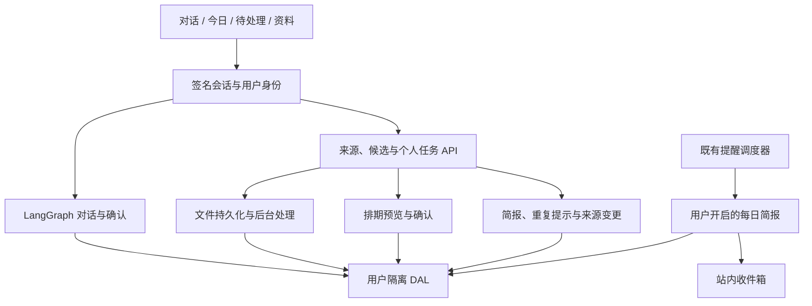

# Personal Agent 技术架构

更新于 2026-11-05，面向项目维护与二次开发。

产品是有长期记忆的个人安排助理。网页提供对话、今日、待处理和资料四个入口，消息、文档与会议中的事项经确认进入同一任务体系，再衔接排期、提醒和简报。第四、第五阶段功能已开发，测试与验收按用户安排后置。

## 1. 一句话

对话经 LangGraph 处理，个人安排经独立领域 API 保存。两条路径复用服务端会话、用户隔离、模型网关及提醒基础设施。资料整理形成候选事项，用户确认后创建或关联任务，排期方案和来源变更各自经过预览确认。

## 2. 分层

| 层 | 职责 | 代码 |
|----|------|------|
| 入口 | 网页会话、飞书长连接、OpenClaw 微信桥；一次性链接绑定到网页会话 | `app/main.py`、`app/session_identity.py`、`app/channels/` |
| 编排 | 意图路由、子图、预算循环、确认中断、失败隔离 | `app/graph.py`、`app/agent/router.py`、`app/agent/subgraphs/`、`app/agent/loop.py` |
| 个人任务 | 原文、候选引用、归属核对、任务状态、独立提醒与变更历史 | `app/arrangements/`、`app/data_access/arrangements.py` |
| 文件资料 | PDF 文字与表格、扫描页 OCR、录音分块与转写、分段速读、资料版本、来源定位与问答 | `app/materials/`、`app/data_access/materials.py` |
| 智能安排 | 可用时段、固定事件、容量与缓冲、前置任务、时间块、排期预览、版本检查、日历文件导出 | `app/planning/`、`app/data_access/planning.py` |
| 跟进 | 每日简报、快照、重复事项提示、来源变更对比与确认 | `app/arrangements/followup_api.py`、`app/arrangements/briefs.py`、`app/data_access/followup.py` |
| 资料检索 | 跨资料 SQL 文本匹配、标签、版本与状态筛选、原文位置及向量分块清单 | `app/library/`、`app/data_access/library.py` |
| 本机交付 | 启动与停止、进程归属核对、配置状态和首次使用进度 | `scripts/local_app.py`、`app/setup/api.py`、`static/js/setup.js` |
| 工具 | 统一注册、风险等级、确认门禁、超时、审计 | `app/agent/tool_registry.py`、`app/tools/` |
| 记忆 | 档案（通用字段 + 对话摘要）、情节事件、可选向量事实、用户可编辑的记忆卡 | `app/agent/memory/`、`app/db.py`、`app/data_access/` |
| 模型 | FAST / STRONG 分档、多厂商模型链、降级、限流、用量 | `app/gateway/`、`app/llm.py` |
| 护栏 | 危机识别与热线、提示词泄露、他人数据、隐私沙盒、PII 拦截 | `app/agent/harness/`、`app/privacy.py`、`app/secrets_vault.py` |
| 主动 | 定时任务调度（一次性提醒、自定义只读任务）与渠道推送 | `app/agent/proactive/`、`app/agent/schedules/` |
| 观测 | 步骤轨迹、LLM 调用记录、Langfuse 导出、反馈、管理审计 | `app/agent/harness/traces.py`、`app/observability/`、`app/admin/` |

## 3. 一次对话的生命周期

1. `SessionIdentityMiddleware` 从签名 cookie 取 `user_id`，所有数据访问进入 `user_scope`。
2. `/api/chat` 先过隐私门：密码 / 手机号 / 身份证直接拦截，改出安全输入区卡片。
3. 意图：有 key 时模型选工具（`draft_text` / `schedule.*` / 联网读取），离线用规则。
4. `run_action` 进图：
   - `chat`：拼人设 + 提问卡规则 + 记忆上下文 → 模型 → 泄露护栏 → 拆出 `<ask>` 卡 → 写情节事件 → 后台摘要。
   - `draft`：`run_task_loop` 调 `draft_text` 出稿并自检 → `await_confirm` 用 LangGraph `interrupt` 停住。
5. 前端渲染确认卡；用户确认 / 拒绝（可编辑正文、可写原因）→ `/api/confirm` 用一次性凭证恢复图。拒绝时预算内自动重写一版。
6. 每个节点经 `node_wrap`：计步、计 token、护栏扫描、轨迹落库；预算接近上限先升档，再交付并给「继续」卡。

## 4. 数据

SQLite（默认）或 Postgres（RLS，见 `docs/postgres-rls.md`）。私有表：`user_profiles`、`episodic_events`、`memory_facts`、`confirm_*`、`channel_*`、`user_secrets`、`user_schedules*`、`proactive_*`、`turn_results`。审计表独立引擎：`agent_traces`、`admin_*`、`feedback`。

个人安排扩展增加以下私有数据。

| 数据 | 表 |
|---|---|
| 来源、候选、任务及历史 | `arrangement_sources`、`arrangement_candidates`、`arrangement_tasks`、`arrangement_changes` |
| 文件、版本、片段、后台任务与结果 | `material_assets`、`material_versions`、`material_units`、`material_jobs`、`material_parts`、`material_artifacts`、`material_candidate_refs` |
| 日程、排期信息、时间块及预览 | `planning_calendars`、`planning_events`、`planning_timings`、`planning_blocks`、`planning_proposals`、`planning_changes` |
| 简报设置、简报快照、重复判断及来源变更预览 | `arrangement_brief_preferences`、`arrangement_briefs`、`arrangement_match_decisions`、`arrangement_update_proposals` |
| 根资料标签与元数据版本 | `library_metadata`、`library_tags` |

新增表在 `app/db.py` 注册，通过 `app/data_access/session.py` 的私有表集合施加用户范围。Postgres 由现有 owner migration 建表并安装 RLS。跨实体写入沿用 `db.memory_transaction()`，SQLite 使用写事务串行化，排期及来源变更同时锁定用户日程。

档案 JSON 字段：`name`、`city`、`tz`、`occupation`、`interests[]`、`preferences[]`、`facts[]`、`pinned_fields`、`memory_rev`、`dialogue_summary`、`privacy_sandbox`。

个人记忆保存用户事实与偏好。资料库保存原文、转写、结果及引用，支持跨资料 SQL 文本匹配、标签与版本筛选。当前资料问答使用关键词和中文相邻字检索。资料向量检索已准备分块清单和 `knowledge_embed` 配置状态接口，索引构建与语义查询待接入。

### 4.1 来源到任务

文本保存后形成不可变来源，模型或手动操作产生候选项，逐字引用定位到原文。用户决定创建个人任务、关联已有任务、保存参考或忽略。非本人归属需要明确承担确认。文件资料另有版本与片段，任务保留采纳时版本的出处。

### 4.2 排期到调整

排期引擎读取工作时段、固定事件、工作量和前置关系，生成新增、保留、取消及未安排事项。预览持久化 30 分钟，确认时重新核对日程版本和输入快照，再原子保存时间块。任务状态由明确反馈更新，完成、取消或等待时清理尚未结束的时间块。

### 4.3 简报、重复与来源变更

简报按已保存数据汇总今日安排、临期、逾期、等待、冲突及待决定事项。用户可以保存快照，或选择每日时间和内容。默认关闭定时推送，开启后复用 `app/agent/proactive/jobs.py` 的调度周期。快照、站内收件项和当日生成记录在同一事务中保存。

重复提示使用规范化标题、文字相似度和资料版本关系。用户可关联已有任务，或保存“这不是同一件事”的判断。判断按候选与任务的具体组合保存。

来源变化通过独立预览核对标题、截止时间和责任处理。用户填写或核对新值后确认，保存前检查任务版本与候选状态。责任变化对应等待他人或取消个人任务，变更原因与新旧值进入任务历史。日期变化会提示核对未来时间块，随后由用户选择重新排期。

## 5. 安全与边界

- 不替用户对外发任何东西；草稿只在确认后定稿，也不自动发送。
- 隐私不进聊天：敏感信息走加密保险库（`SECRETS_FERNET_KEY`），模型看不到明文。
- 出站全部过泄露护栏；护栏自身失败 fail closed。
- 自定义定时任务只能用只读白名单工具。
- 管理接口需每人一枚令牌，访问写审计。

## 6. 配置与部署

`.env.example` 列出全部键；`render.yaml` 一键 Render；`Dockerfile` 生产镜像；CI 门禁 `scripts/harness_golden.py`（pytest + 金标）。

本机服务使用 FastAPI 与 SQLite，网页静态资源由同一进程提供。资料云服务已准备百炼配置，文字使用 `qwen-plus`，扫描页使用 `qwen3-vl-plus`，转写使用百炼原生语音接口。Key 由用户最后在本机填写，配置入口为 `scripts/configure_bailian.py`。应用内排期、简报和文字规则提示可独立于模型服务运行。

macOS 双击入口调用 `scripts/local_app.py`，通过文件锁串行化启动操作，核对工作目录、系统用户、命令与进程启动时间后复用或停止本项目进程。运行记录与日志保存在项目 `data/launcher`。首次缺少本机配置时生成随机签名密钥与空服务密钥预设。

`/api/arrangements/setup` 通过现有用户会话读取有效模型配置、后台状态、个人设置和保存进度。网页「设置与开始指南」提供服务状态及收集、确认、排期与简报入口。模型状态表示当前进程的字段配置，实际服务响应仍进入后续联调。

外部日历自动连接与同步仍待接入，当前支持应用内保存与 `.ics` 文件导出。每日简报投递到站内收件箱。云端识别效果、第四／第五阶段业务流程及浏览器交互均保留待验收状态。

## 7. 图示

见 `docs/mmd/`（Mermaid）。

维护说明见 [基础任务流程](arrangements.md)、[资料与云服务](materials.md)、[应用内排期](planning.md) 和 [简报与来源跟进](followup.md)。

全文匹配、标签和分块接口见 [个人知识库基础版](library.md)。

双击入口与开始指南见 [本机使用说明](local-use.md)。
